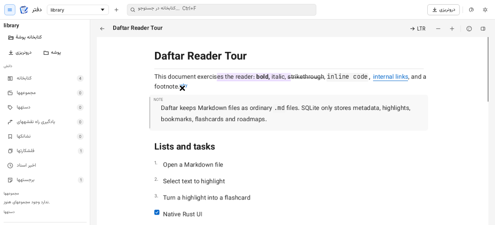
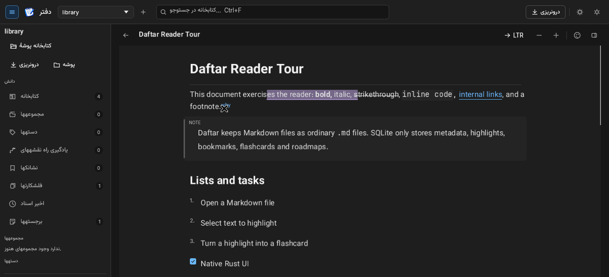
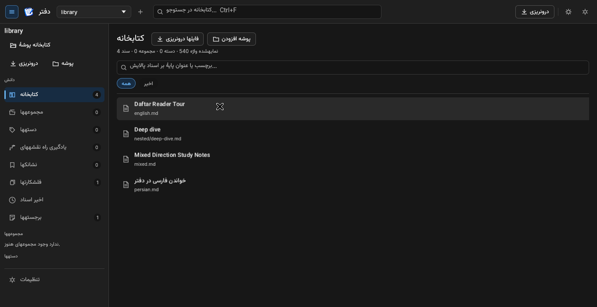
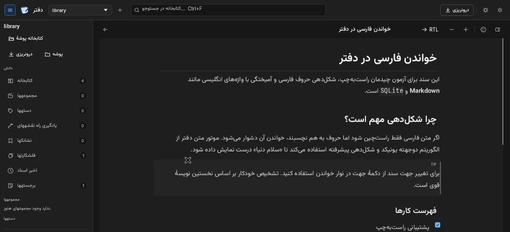

<div dir="rtl">

# دفتر

### بهترین Markdown Reader جهان

The World's Best Markdown Reader · [English](README.md)

دفتر یک خوانندهٔ رومیزی و استودیوی دانش برای Markdown است که با Rust بومی نوشته شده است:
بدون JavaScript، WebView، Electron یا Tauri؛ تنها یک فایل اجرایی که بر پایهٔ egui/eframe و
cosmic-text ساخته شده و از نخست برای متن فارسی/عربی راستبهچپ طراحی شده است.



| رابط تیره | کتابخانهٔ دانش | سند فارسی (راستبهچپ) |
| --- | --- | --- |
|  |  |  |

## ویژگیها

- **خواننده** — سرفصلها، جدولها، فهرستهای کار، پانوشتها، نقلقولها و کادرها، برجستهسازی
  نحو کد (syntect)، تصاویر رستری و SVG، پیشرفت خواندن و زمان باقیمانده.
- **راستبهچپ** — ترکیببندی حروف فارسی/عربی با لیگاتور، دوجهتهٔ یونیکد، تشخیص خودکار جهت
  هر سند و پشتیبانی از اسناد دوجهته. انتخاب متن، برجستهها و نشانکها با لنگرهای متنسند ذخیره
  میشوند و پس از ویرایش فایل باقی میمانند.
- **نمودارها** — زیرمجموعهای بومی از Mermaid (فلوچارت/گراف، توالی، کلاس، حالت، ER، گانت،
  دایرهای، نقشهٔ ذهنی و سفر) با جابهجایی، بزرگنمایی و برونریزی PNG. دستورهای پشتیبانینشده
  خطای صریح نشان میدهند و نمودار جعلی نمیسازند.
- **کتابخانهٔ دانش** — پایگاه دادهٔ SQLite/FTS5 با مجموعهها، دستهها، برچسبها، جستوجوی کامل،
  برجستهها، نشانکها، فلشکارتها و نقشههای راه یادگیری.
- **برونریزی** — PDF با قلمهای TrueType جاسازیشده و نقشهٔ ToUnicode، کارتهای PNG، برونریزی
  دستهای و بایگانی کتابخانه (ZIP با تصویر SQLite و مانیفست نسخهدار).
- **زبان رابط** — انگلیسی و فارسی با تغییر زنده در تنظیمات.
- **حالت قابلحمل** — اجرا از حافظهٔ USB؛ همهچیز کنار فایل اجرایی میماند.
- **پوستهها** — پوستهٔ روشن و تیرهٔ رابط، و پوستههای مطالعه که از حالت رابط پیروی میکنند
  (پوستههای سفارشی همانگونه که ساخته شدهاند باقی میمانند).

## بارگیری

همهٔ نسخهها: <https://github.com/mtafakori1993/daftar/releases>

| سامانه | بسته | توضیح |
| --- | --- | --- |
| لینوکس x86_64 | `daftar-<version>-linux-x86_64.tar.gz` | TAR.GZ قابلحمل (پیشنهادی) |
| لینوکس x86_64 | `daftar-<version>-linux-x86_64-portable.zip` | ZIP قابلحمل با نشانگر `daftar.portable` |
| لینوکس x86_64 | `daftar_<version>_amd64.deb` | بستهٔ دبیان/اوبونتو با میانبر منوی برنامهها |
| لینوکس x86_64 | `daftar-<version>-linux-x86_64.AppImage` | فایل اجرایی تکفایلی بدون نصب |
| ویندوز x86_64 | `daftar-<version>-windows-x86_64-setup.exe` | نصبکننده (کاربری، بدون دسترسی مدیر) |
| ویندوز x86_64 | `daftar-<version>-windows-x86_64-portable.zip` | ZIP قابلحمل بدون نصب |
| همه | `SHA256SUMS` | بررسی صحت همهٔ فایلها |

هر نسخه همچنین `README.md`، `README.fa.md`، `LICENSE` و اسناد نمونهٔ `samples/` را همراه دارد.

## نصب در لینوکس

**دبیان / اوبونتو (پیشنهادی)**

```bash
sudo apt install ./daftar-<version>_amd64.deb
daftar
```

این بسته `/usr/bin/daftar`، میانبر دسکتاپ و نقشکها را نصب میکند، بنابراین دفتر در منوی
برنامههای GNOME، KDE و سایر میزکارها ظاهر میشود. برای حذف: `sudo apt remove daftar`.

**AppImage**

```bash
chmod +x daftar-<version>-linux-x86_64.AppImage
./daftar-<version>-linux-x86_64.AppImage
```

**TAR.GZ قابلحمل**

```bash
tar -xzf daftar-<version>-linux-x86_64.tar.gz
./daftar-<version>-linux-x86_64/daftar
```

## نصب در ویندوز

**نصبکننده**

۱. فایل `daftar-<version>-windows-x86_64-setup.exe` را اجرا کنید.
۲. پوشهٔ نصب را انتخاب کنید؛ میانبر منوی شروع و برنامهٔ حذف ساخته میشود.
۳. نصب در سطح کاربر انجام میشود، پس دسترسی مدیر لازم نیست.

**ZIP قابلحمل**

۱. `daftar-<version>-windows-x86_64-portable.zip` را هرجا باز کنید.
۲. فایل `daftar.exe` را اجرا کنید؛ بدون نصب و بدون دسترسی مدیر.

## حالت قابلحمل

ساختهای قابلحمل همهٔ دادهها را کنار فایل اجرایی نگه میدارند. کافی است فایل نشانگر
`daftar.portable` کنار فایل اجرایی باشد تا پایگاه داده، تنظیمات، قلمهای درونریزیشده و
کتابخانهٔ پیشفرض در پوشهٔ `data/` کنار همان فایل ذخیره شوند:

```
daftar-<version>-linux-x86_64-portable/
├── daftar            (در ویندوز: daftar.exe)
├── daftar.portable   نشانگر فعالسازی حالت قابلحمل
├── data/             ساخته و مدیریتشده توسط دفتر
└── samples/
```

همچنین میتوانید مکان داده را صریح تعیین کنید:

```bash
./daftar --data-dir /media/usb/daftar-data     # پوشهٔ دادهٔ مشخص
DAFTAR_DATA_DIR=/tmp/daftar ./daftar           # متغیر محیطی
DAFTAR_PORTABLE=1 ./daftar                     # اجبار حالت قابلحمل
./daftar --check                               # نمایش مسیرها، یکپارچگی و قلمها
```

## ساخت از کد

نیازمندیها: Rust نسخهٔ ۱٫۸۵ یا بالاتر (stable)، ابزار زنجیرهٔ C و سرفصلهای توسعهٔ
دسکتاپ لینوکس (`libgl1-mesa-dev libxkbcommon-dev libwayland-dev libx11-dev` و مانند آن).

```bash
cargo build --release -p daftar-app
./target/release/daftar --version
./target/release/daftar --check
```

بررسیهای کیفی:

```bash
cargo test --workspace
cargo clippy --workspace --all-targets
cargo fmt --all -- --check
```

### بستهبندی و انتشار

| اسکریپت | کارکرد |
| --- | --- |
| `scripts/build-linux.sh` | آزمونها، clippy و ساخت فایل اجرایی لینوکس |
| `scripts/package-linux.sh` | TAR.GZ، ZIP قابلحمل، DEB و AppImage همراه `SHA256SUMS` و اعتبارسنجی |
| `scripts/build-windows.ps1` | آزمونها، clippy و ساخت فایل اجرایی ویندوز |
| `scripts/package-windows.ps1` | ZIP قابلحمل، نصبکنندهٔ Inno Setup و MSI اختیاری |
| `scripts/release-notes.sh` | ساخت `docs/releases/v<version>.md` |
| `scripts/release.sh` | بررسیهای پیش از انتشار، ساخت برچسب و ارسال (انتشار در CI) |

نسخه تنها از `Cargo.toml` فضای کاری خوانده میشود و نام فایلها، برچسب گیت (`vX.Y.Z`) و
عنوان نسخه از آن ساخته میشوند.

```bash
scripts/package-linux.sh        # ساخت بومی و بازتولیدپذیر بستههای لینوکس
scripts/release.sh --dry-run    # آمادهسازی بدون برچسب و ارسال
scripts/release.sh              # ساخت برچسب vX.Y.Z و ارسال آن
```

ارسال برچسب `v*` گردشکار [`.github/workflows/release.yml`](.github/workflows/release.yml) را
اجرا میکند: بررسیهای کیفی، ساخت بستههای لینوکس روی `ubuntu-22.04` و ویندوز روی
`windows-latest`، اعتبارسنجی همهٔ بستهها و چکسامها، و انتشار نسخهٔ GitHub با نام
«Daftar vX.Y.Z» همراه دستورهای نصب و `SHA256SUMS`.

## بررسی صحت بارگیری

```bash
sha256sum -c SHA256SUMS                        # لینوکس
Get-FileHash -Algorithm SHA256 .\<file>         # ویندوز (PowerShell)
```

## پشتهٔ فناوری

| لایه | فناوری |
| --- | --- |
| زبان | Rust 2021 (کمینهٔ ۱٫۸۵) |
| پنجره/رابط | `eframe` / `egui` 0.37 با OpenGL (`glow`)، X11 و Wayland |
| ترکیببندی متن | `cosmic-text` (در کلاس HarfBuzz)، `rustybuzz`، دوجهتهٔ یونیکد |
| Markdown | `pulldown-cmark` با رندرکننده و موتور چیدمان اختصاصی |
| نمودارها | تجزیهگر و رندرکنندهٔ Mermaid زیرمجموعه، نوشتهشده در همین پروژه |
| ذخیرهسازی | `rusqlite` (SQLite همراه) با FTS5 |
| برجستهسازی کد | `syntect` |
| تصویر/SVG | `image`، `resvg`/`usvg`، `tiny-skia` |
| PDF | `pdf-writer` با قلمهای TrueType و نقشهٔ ToUnicode |
| قلمها | Inter، Vazirmatn، JetBrains Mono (SIL OFL، همراه برنامه) |

## ساختار مخزن

```
crates/daftar-core      مدل، تنظیمات، تجزیهٔ Markdown، لنگرها، قالب بایگانی
crates/daftar-text      ثبت قلم، ترکیببندی، چیدمان، آزمون برخورد، ترسیم
crates/daftar-diagram   تجزیه و رندر نمودارهای Mermaid
crates/daftar-store     طرحوارهٔ SQLite، مهاجرتها، CRUD، جستوجو، دادههای مطالعه
crates/daftar-export    کارتهای PDF/PNG، برونریزی دستهای، بایگانی کتابخانه
crates/daftar-ui        پوسته، ویجتها، نمایشگر سند و همهٔ صفحهها
crates/daftar-app       مسیرهای قابلحمل، خط فرمان، گزارشگیری، راهاندازی eframe
samples/                اسناد نمونهٔ Markdown
docs/                   تصاویر، میانبر لینوکس و metainfo، اسکریپت نصب ویندوز، یادداشت نسخهها
scripts/                ساخت، بستهبندی و خودکارسازی انتشار
```

## مشارکت

۱. مخزن را فورک کنید و یک شاخهٔ موضوعی بسازید.
۲. `cargo fmt`، `cargo clippy --workspace --all-targets` و `cargo test --workspace` باید بدون خطا باشند.
۳. برای تغییرهای رفتاری آزمون اضافه کنید (فضای کاری بیش از ۱۹۰ آزمون دارد، از جمله
   ترکیببندی راستبهچپ، بازنشانی لنگر، تجزیهٔ نمودار، فروشگاه و برونریزی).
۴. اثر تغییر روی کاربر را در درخواست ادغام توضیح دهید؛ برای تغییرهای رابط، تصویر کمککننده است.

گزارش خطا و درخواست ویژگی: <https://github.com/mtafakori1993/daftar/issues>

## مجوز

MIT — فایل [LICENSE](LICENSE) را ببینید. قلمهای همراه (Inter، Vazirmatn، JetBrains Mono)
زیر مجوز SIL Open Font License منتشر شدهاند؛ فایلهای `assets/fonts/*-LICENSE.txt` و
`assets/fonts/*-OFL.txt` را ببینید.

</div>
