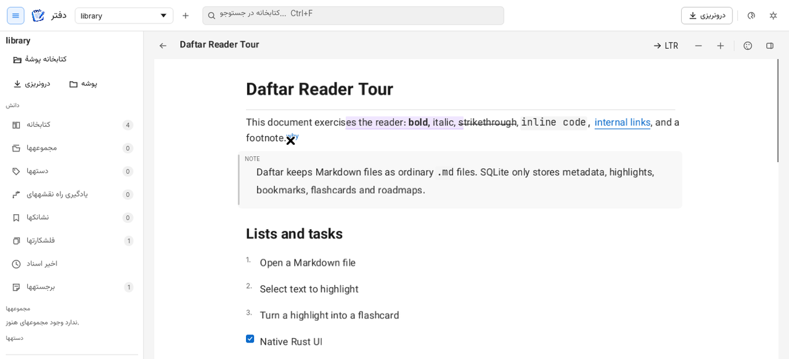
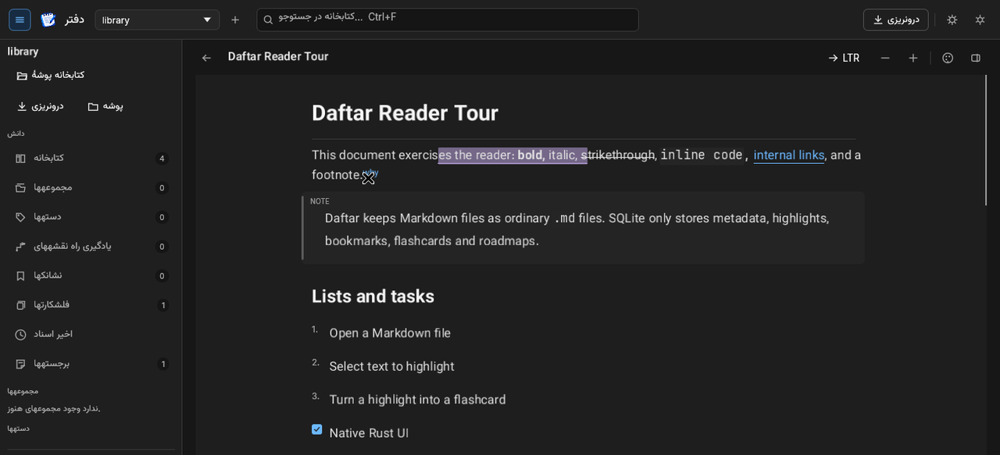
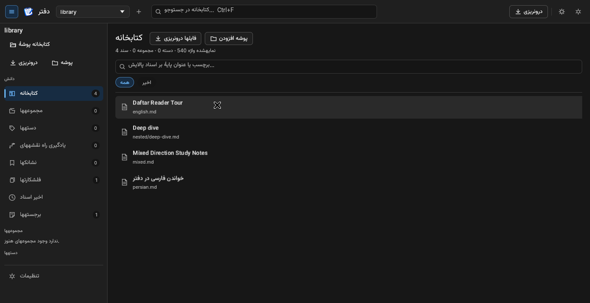
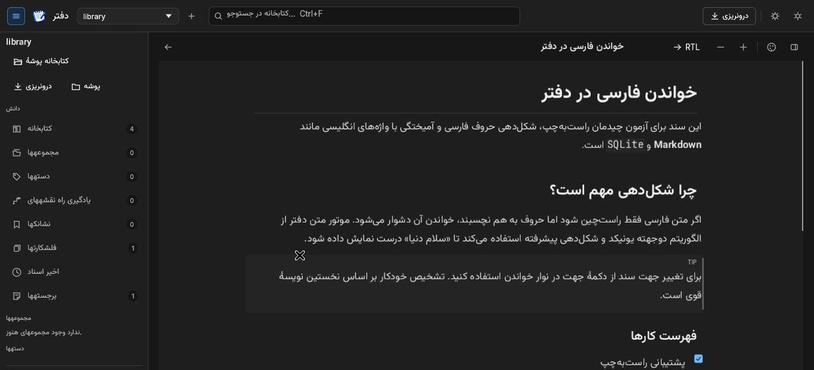

# Daftar

### The World's Best Markdown Reader

بهترین Markdown Reader جهان · [فارسی](README.fa.md)

[](https://github.com/mtafakori1993/daftar/actions/workflows/ci.yml)
[](https://github.com/mtafakori1993/daftar/actions/workflows/release.yml)
[](LICENSE)

A native Rust desktop Markdown reader and knowledge studio. No JavaScript, WebView,
Electron or Tauri — one compiled binary built on egui/eframe and cosmic-text, with
first-class Persian/Arabic right-to-left support.



| Dark interface | Knowledge library | Persian (RTL) document |
| --- | --- | --- |
|  |  |  |

## Features

- **Reader** — headings, tables, task lists, footnotes, quotes and callouts, syntax-highlighted
  code (syntect), raster and SVG images, reading progress and time remaining.
- **RTL-first** — Persian/Arabic shaping with ligatures, Unicode bidi, automatic per-document
  direction detection and mixed-direction documents. Selections, highlights and bookmarks use
  source-anchored ranges that survive file edits.
- **Diagrams** — a native Mermaid subset (flowchart/graph, sequence, class, state, ER, gantt,
  pie, mindmap, journey) with pan, zoom and PNG export. Unsupported directives show an explicit
  error instead of a fake diagram.
- **Knowledge library** — SQLite/FTS5 store with collections, categories, tags, full-text search,
  highlights, bookmarks, flashcards and study roadmaps.
- **Export** — PDF with embedded TrueType fonts and ToUnicode, PNG cards, batch export, and
  versioned library archives (ZIP with a SQLite snapshot and manifest).
- **Interface languages** — English and Persian (فارسی), switchable live in Settings.
- **Portable mode** — run from a USB drive; everything lives beside the executable.
- **Adaptive theming** — light and dark interface themes, with reading themes that follow the
  interface mode (custom reading themes are respected as authored).

## Download

All releases: <https://github.com/mtafakori1993/daftar/releases>

| Platform | Package | Notes |
| --- | --- | --- |
| Linux x86_64 | `daftar-<version>-linux-x86_64.tar.gz` | Portable TAR.GZ (recommended) |
| Linux x86_64 | `daftar-<version>-linux-x86_64-portable.zip` | Portable ZIP with `daftar.portable` marker |
| Linux x86_64 | `daftar_<version>_amd64.deb` | Debian/Ubuntu package, application-menu entry |
| Linux x86_64 | `daftar-<version>-linux-x86_64.AppImage` | Single-file app, no installation |
| Windows x86_64 | `daftar-<version>-windows-x86_64-setup.exe` | Installer (per-user, no admin rights) |
| Windows x86_64 | `daftar-<version>-windows-x86_64-portable.zip` | Portable ZIP, no installation |
| Any | `SHA256SUMS` | Checksums for every artifact |

Every release also ships `README.md`, `README.fa.md`, `LICENSE` and the `samples/` documents.

## Installation — Linux

**Debian / Ubuntu (recommended)**

```bash
sudo apt install ./daftar-<version>_amd64.deb
daftar
```

This installs `/usr/bin/daftar`, a desktop entry and hicolor icons, so Daftar appears in the
application menu of GNOME, KDE and other desktops. Remove it with `sudo apt remove daftar`.

**AppImage**

```bash
chmod +x daftar-<version>-linux-x86_64.AppImage
./daftar-<version>-linux-x86_64.AppImage
```

**Portable TAR.GZ**

```bash
tar -xzf daftar-<version>-linux-x86_64.tar.gz
./daftar-<version>-linux-x86_64/daftar
```

The portable build uses the platform data directory (`~/.local/share/daftar`) unless a
`daftar.portable` marker is present next to the executable.

## Installation — Windows

**Installer**

1. Run `daftar-<version>-windows-x86_64-setup.exe`.
2. Choose the installation directory; a Start Menu shortcut and an uninstaller are created.
3. A per-user installation is performed, so administrator rights are not required.

**Portable ZIP**

1. Extract `daftar-<version>-windows-x86_64-portable.zip` anywhere.
2. Run `daftar.exe` — no installation, no administrator rights.

## Portable usage

Portable builds keep all state beside the executable. Ship a marker file next to the binary and
Daftar stores its database, settings, imported fonts and default library in a `data/` folder
next to it:

```
daftar-<version>-linux-x86_64-portable/
├── daftar            (daftar.exe on Windows)
├── daftar.portable   marker enabling portable mode
├── data/             created and owned by Daftar
└── samples/
```

You can also override the location:

```bash
./daftar --data-dir /media/usb/daftar-data     # explicit data directory
DAFTAR_DATA_DIR=/tmp/daftar ./daftar           # environment variable
DAFTAR_PORTABLE=1 ./daftar                     # force portable mode
./daftar --check                               # print paths, integrity and font report
```

## Build from source

Requirements: Rust 1.85+ (stable), a C toolchain, and the usual Linux desktop development
headers (`libgl1-mesa-dev libxkbcommon-dev libwayland-dev libx11-dev` and friends).

```bash
cargo build --release -p daftar-app
./target/release/daftar --version
./target/release/daftar --check
```

Quality gates:

```bash
cargo test --workspace
cargo clippy --workspace --all-targets
cargo fmt --all -- --check
```

### Packaging and releasing

| Script | Purpose |
| --- | --- |
| `scripts/build-linux.sh` | Tests, clippy and the Linux release binary |
| `scripts/package-linux.sh` | TAR.GZ, portable ZIP, DEB and AppImage + `SHA256SUMS` + validation |
| `scripts/build-windows.ps1` | Tests, clippy and the Windows release binary |
| `scripts/package-windows.ps1` | Portable ZIP, Inno Setup installer, optional MSI |
| `scripts/release-notes.sh` | Generates `docs/releases/v<version>.md` |
| `scripts/release.sh` | Pre-flight checks, tag creation and push (CI publishes) |
| `scripts/package.sh` | Legacy convenience wrapper for the portable Linux packages |

The version comes from the workspace `Cargo.toml` only; scripts derive artifact names, the Git
tag (`vX.Y.Z`) and the release title from it.

```bash
# local, reproducible build of the Linux artifacts
scripts/package-linux.sh

# prepare a release (refuses on a dirty tree, refuses to move an existing tag)
scripts/release.sh --dry-run
scripts/release.sh            # creates tag vX.Y.Z and pushes it
```

Pushing a `v*` tag triggers [`.github/workflows/release.yml`](.github/workflows/release.yml),
which runs the quality gates, builds Linux artifacts on `ubuntu-22.04` and Windows artifacts on
`windows-latest`, verifies every archive and checksum, and publishes a GitHub Release named
`Daftar vX.Y.Z` with installation instructions and `SHA256SUMS`.

## Verify a download

```bash
sha256sum -c SHA256SUMS                        # Linux
Get-FileHash -Algorithm SHA256 .\<file>         # Windows PowerShell
```

## Technology stack

| Layer | Choice |
| --- | --- |
| Language | Rust 2021 (MSRV 1.85) |
| Windowing / UI | `eframe` / `egui` 0.37 with OpenGL (`glow`), X11 + Wayland |
| Text shaping | `cosmic-text` (HarfBuzz-class shaping), `rustybuzz`, Unicode bidi |
| Markdown | `pulldown-cmark`, custom renderer and layout engine |
| Diagrams | in-house Mermaid-subset parser and renderer |
| Storage | `rusqlite` (bundled SQLite) with FTS5 |
| Syntax highlighting | `syntect` |
| Raster/SVG | `image`, `resvg`/`usvg`, `tiny-skia` |
| PDF | `pdf-writer` with embedded TrueType fonts and ToUnicode maps |
| Fonts | Inter, Vazirmatn, JetBrains Mono (SIL OFL, bundled) |

## Repository layout

```
crates/daftar-core      model, settings, Markdown parsing, anchors, archive format
crates/daftar-text      font registration, shaping, layout, hit-testing, painting
crates/daftar-diagram   Mermaid subset parsers and renderers
crates/daftar-store     SQLite schema, migrations, CRUD, search, study data
crates/daftar-export    PDF/PNG cards, batch export, library archives
crates/daftar-ui        theme, widgets, reader view, all application views
crates/daftar-app       portable paths, CLI, logging, eframe bootstrap
samples/                demonstration Markdown documents
docs/                   screenshots, Linux desktop/metainfo, Windows installer script, release notes
scripts/                build, packaging and release automation
```

## Contributing

1. Fork the repository and create a topic branch.
2. Keep `cargo fmt`, `cargo clippy --workspace --all-targets` and `cargo test --workspace` clean.
3. Add tests for behaviour changes (the workspace has 190+ tests, including RTL shaping,
   anchor relocation, diagram parsing, store and export coverage).
4. Describe the user-visible effect in the pull request; screenshots help for UI changes.

Bug reports and feature requests: <https://github.com/mtafakori1993/daftar/issues>

## License

MIT — see [LICENSE](LICENSE). Bundled fonts (Inter, Vazirmatn, JetBrains Mono) are licensed
under the SIL Open Font License; see `assets/fonts/*-LICENSE.txt` and `assets/fonts/*-OFL.txt`.
