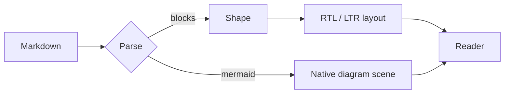
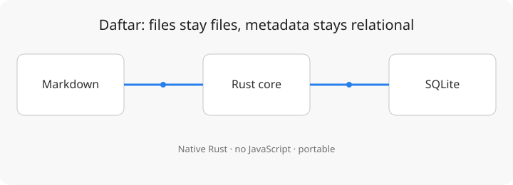

# Daftar Reader Tour

This document exercises the reader: **bold**, *italic*, ~~strikethrough~~, `inline code`, [internal links](nested/deep-dive.md), and a footnote.[^why]

> [!NOTE]
> Daftar keeps Markdown files as ordinary `.md` files. SQLite only stores metadata, highlights, bookmarks, flashcards and roadmaps.

## Lists and tasks

1. Open a Markdown file
2. Select text to highlight
3. Turn a highlight into a flashcard

- [x] Native Rust UI
- [x] Reshaped Persian text
- [ ] Read every chapter

Nested lists:

- Reading
  - Typography
    - Line height and reading width
  - Direction detection
- Studying
  - Flashcards
  - Roadmaps

## Code

```rust
fn main() {
    let library = Library::open("notes")?;
    for document in library.documents()? {
        println!("{}", document.title);
    }
}
```

Inline code: `cargo run --release`.

## Tables

| Feature | Native Rust | Notes |
|:--------|:-----------:|------:|
| Markdown | Yes | pulldown-cmark |
| RTL shaping | Yes | cosmic-text + HarfBuzz-class shaping |
| PDF text | Yes | embedded TrueType fonts |
| Mermaid | Subset | no JavaScript or WebView |

## A diagram





## Mathematics

Inline math like $e^{i\pi} + 1 = 0$ is displayed with a practical TeX-to-Unicode fallback.

$$
\alpha + \beta = \gamma
$$

## Persian and mixed direction

Persian text appears in its own document and can also be mixed here: «دانش» means knowledge, and the word **کتابخانه** means library. The Unicode bidi algorithm decides the visual order of each run.

## Quotes and separators

> “A reader lives a thousand lives before he dies.”
>
> — George R. R. Martin

---

[^why]: Footnotes stay attached to the Markdown and are rendered as links.
