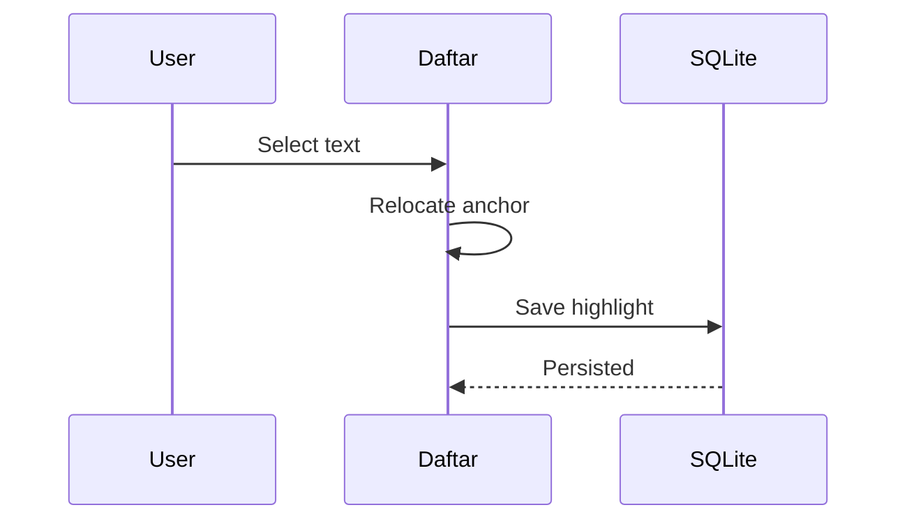

# Deep dive

Nested documents keep their directory structure in the library and on disk.

## Portable data

Configuration, the SQLite database, fonts and the default library live under `data/` beside the executable in portable mode.

[Back to the tour](../english.md)
