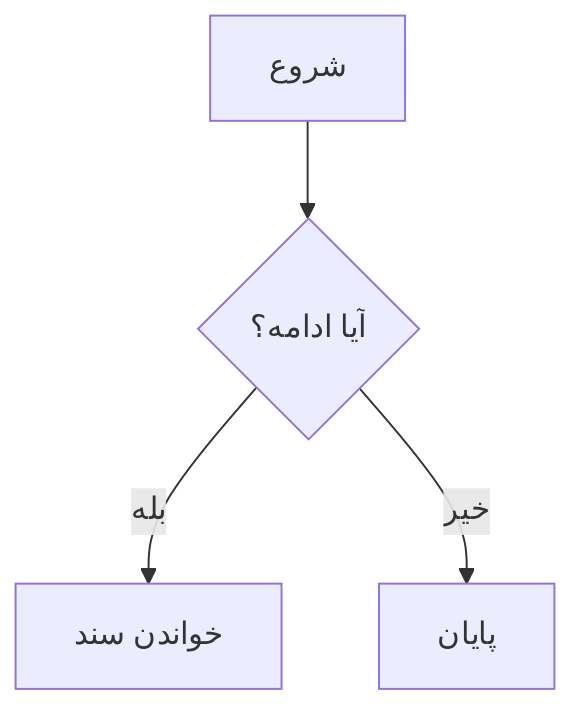

# خواندن فارسی در دفتر

این سند برای آزمون چیدمان راست‌به‌چپ، شکل‌دهی حروف فارسی و آمیختگی با واژه‌های انگلیسی مانند **Markdown** و `SQLite` است.

## چرا شکل‌دهی مهم است؟

اگر متن فارسی فقط راست‌چین شود اما حروف به هم نچسبند، خواندن آن دشوار می‌شود. موتور متن دفتر از الگوریتم دوجهته یونیکد و شکل‌دهی پیشرفته استفاده می‌کند تا «سلام دنیا» درست نمایش داده شود.

> [!TIP]
> برای تغییر جهت سند از دکمهٔ جهت در نوار خواندن استفاده کنید. تشخیص خودکار بر اساس نخستین نویسهٔ قوی است.

### فهرست کارها

- [x] پشتیبانی راست‌به‌چپ
- [x] چیدمان دووجهته
- [ ] مطالعهٔ فصل بعد

### نمونهٔ جدول

| ویژگی | وضعیت | توضیح |
|:------|:-----:|------:|
| نگاره‌ها | فعال | چیدمان صحیح |
| کد | فعال | رنگ‌آمیزی نحوی |
| ریاضی | پایه | تبدیل سادهٔ TeX |

### نمونهٔ کد

```rust
fn سلام() {
    println!("سلام دنیا");
}
```

### نمودار



## پیوندها و پانویس

برای مطالعهٔ بیشتر به [راهنمای انگلیسی](english.md) مراجعه کنید.[^1]

[^1]: پانویس‌ها در پایان سند نمایش داده می‌شوند.
